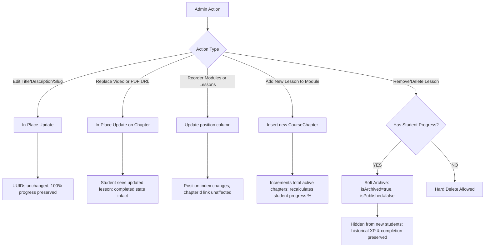

# TECHNICAL AUDIT & ARCHITECTURAL SPECIFICATION: GLOBAL COURSE MANAGEMENT INTEGRATION
## Final Technical Blueprint & Implementation Specification

**Auditor:** Antigravity System Architecture Specialist  
**Source Repository:** `digitalghuru_updated` (`C:\SRI\digitalghuru_updated`)  
**Target Repository:** `digitalghuru-franchise` (`C:\SRI\digitalghuru-franchise`)  
**Target Database:** Dedicated Neon PostgreSQL Database (`digitalghuru-franchise`)  
**Document Status:** Final Technical Blueprint (Read-Only Stage)  

---

## 1. COMPLETE SOURCE-TO-TARGET COURSE FIELD MAPPING

The source repository's 10-step `CourseWizard.tsx` (1,852 lines), `CourseEditor.tsx`, `CurriculumManager.tsx`, and `app/api/courses/route.ts` were inspected line-by-line. The table below maps every single field from the source system to its exact representation in the target Franchise architecture:

| Wizard Step | Source Field / Key | Source Type | Target Entity & Field | Target Data Type | Notes & Serialization |
|---|---|---|---|---|---|
| **Step 1: Basic** | `title` | `VARCHAR(255)` | `GlobalCourse.title` | `String` | Core title indexed for full-text search |
| **Step 1: Basic** | `slug` | `VARCHAR(255)` | `GlobalCourse.slug` | `String @unique` | URL slug, e.g. `ai-powered-digital-marketing` |
| **Step 1: Basic** | `subtitle` | `TEXT` | `GlobalCourse.subtitle` | `String?` | Promotional subtitle / tagline |
| **Step 1: Basic** | `description` | `TEXT` | `GlobalCourse.description` | `String? @db.Text` | In-depth course overview text |
| **Step 1: Basic** | `duration` | `VARCHAR(50)` | `GlobalCourse.duration` | `String?` | e.g., "12 Weeks", "3 Months", "60 Hours" |
| **Step 1: Basic** | `format` | `VARCHAR(100)` | `GlobalCourse.format` | `String?` | e.g., "Classroom + AI Lab", "Self-Paced Online" |
| **Step 1: Basic** | `originalPrice` | `VARCHAR/INT` | `GlobalCourse.originalPrice` | `Decimal(10,2)?` | Strikethrough price in INR |
| **Step 1: Basic** | `discountedPrice` | `DECIMAL(10,2)` | `GlobalCourse.discountedPrice` | `Decimal(10,2)?` | Actual selling fee in INR |
| **Step 1: Basic** | `location` | `VARCHAR(255)` | `GlobalCourse.location` | `String?` | e.g., "Chennai, Hyderabad & Online" |
| **Step 1: Basic** | `batchInfo` | `VARCHAR(255)` | `GlobalCourse.batchInfo` | `String?` | e.g., "Weekend & Weekday Batches Available" |
| **Step 1: Basic** | `cardImage` | `TEXT` | `GlobalCourse.cardImage` | `String?` | 16:9 or 1:1 course thumbnail image URL |
| **Step 1: Basic** | `bannerImage` | `TEXT` | `GlobalCourse.bannerImage` | `String?` | High-res hero banner image URL |
| **Step 1: Basic** | `brochureUrl` | `TEXT` | `GlobalCourse.brochureUrl` | `String?` | Downloadable PDF syllabus / brochure |
| **Step 1: Basic** | Category | (UI grouping) | `GlobalCourse.categoryId` | `String? (FK)` | Relates to `CourseCategory` (see Section 2) |
| **Step 2: Overview** | `overviewDescription` | `string[]` | `GlobalCourse.marketingData` | `Json` | Array of paragraphs detailing the course |
| **Step 2: Overview** | `overviewLearnings` | `string[]` | `GlobalCourse.marketingData` | `Json` | Array of key learning takeaway bullet points |
| **Step 3: Help** | `designedToHelp` | `Object` | `GlobalCourse.marketingData` | `Json` | `{ title, description, benefits: [{ title, description }] }` |
| **Step 4: Features** | `numberedFeatures` | `Object` | `GlobalCourse.marketingData` | `Json` | `{ title, description, features: [{ number, title, subtitle, description, icon, badge }] }` |
| **Step 5: Why DG** | `whyDigitalGhuru` | `Object` | `GlobalCourse.marketingData` | `Json` | `{ title, reasons: [{ number, title, subtitle, description, icon }] }` |
| **Step 6: Audience** | `whoIsThisForData` | `Array` | `GlobalCourse.marketingData` | `Json` | `[{ role, background, description, badge, points }]` |
| **Step 7: Highlights**| `highlightsData` | `Array` | `GlobalCourse.marketingData` | `Json` | `[{ stat, label, description, icon }]` (Metrics / stats) |
| **Step 8: Tools** | `tools` | `string[]` | `GlobalCourse.marketingData` | `Json` | Flat tool names (`["ChatGPT", "Canva", "Meta Ads"]`) |
| **Step 8: Tools** | `categorizedToolsData`| `Array` | `GlobalCourse.marketingData` | `Json` | `[{ category, title, description, tools: [{ name, iconUrl }] }]` |
| **Step 9: Modules** | `modules[i].title` | `VARCHAR(255)` | `CourseModule.title` | `String` | e.g., "Module 1: Audience Research & Strategy" |
| **Step 9: Modules** | `modules[i].position`| `INTEGER` | `CourseModule.position` | `Int` | Sequential ordering index (0, 1, 2...) |
| **Step 9: Lessons** | `lessons[j].title` | `VARCHAR(255)` | `CourseChapter.title` | `String` | e.g., "Understanding Customer Journey & Funnels" |
| **Step 9: Lessons** | `lessons[j].videoUrl`| `TEXT` | `CourseChapter.videoUrl` | `String?` | Google Drive preview, YouTube embed, or video file |
| **Step 9: Lessons** | `lessons[j].duration`| `VARCHAR(20)` | `CourseChapter.duration` | `String?` | Estimated runtime (defaults to "10:00") |
| **Step 9: Lessons** | `lessons[j].pdfUrl` | `TEXT` | `CourseChapter.pdfUrl` | `String?` | Attached lesson PDF worksheet / slide deck |
| **Step 9: Lessons** | `lessons[j].isFree` | `BOOLEAN` | `CourseChapter.isFree` | `Boolean` | Allows preview without active enrollment |
| **Step 9: Lessons** | `lessons[j].position`| `INTEGER` | `CourseChapter.position` | `Int` | Lesson order within module (0, 1, 2...) |
| **Step 10: FAQs** | `faqs` | `Array` | `GlobalCourse.marketingData` | `Json` | `[{ question, answer }]` |

---

## 2. COURSE CATEGORY ARCHITECTURE

In the source application, courses represent distinct technical disciplines (e.g., *Digital Marketing with AI*, *Full Stack Development*, *Data Science*, *Creative Design*). To allow systematic browsing and filtering without modifying any existing academic structures, we introduce a dedicated, relational `CourseCategory` model:

```prisma
model CourseCategory {
  id          String         @id @default(uuid())
  name        String         @unique // e.g. "Digital Marketing & AI", "Full Stack Development"
  slug        String         @unique // e.g. "digital-marketing-ai", "full-stack-development"
  description String?        @db.Text
  icon        String?        // Lucide icon token, e.g. "TrendingUp", "Code", "Brain"
  position    Int            @default(0)
  isActive    Boolean        @default(true)
  createdAt   DateTime       @default(now())
  updatedAt   DateTime       @updatedAt

  courses     GlobalCourse[]

  @@index([slug])
  @@index([isActive])
}
```

### Key Category Rules:
1. **Platform-Wide Reusability:** Managed exclusively by Super Admin.
2. **Franchise Browsing:** Franchise Admins can filter the global catalogue by category when selecting course offerings.
3. **Safe Dissociation:** If a category is deleted, courses retain their contents and dissociate gracefully (`onDelete: SetNull`).

---

## 3. FINAL PRISMA SCHEMA PROPOSAL (STRICTLY ADDITIVE)

All additions are strictly additive. All existing 54 models in `server/prisma/schema.prisma` are preserved.

```prisma
// ============================================================================
// 1. NEW ENUMS
// ============================================================================

enum CourseStatus {
  DRAFT
  PUBLISHED
  ARCHIVED
}

enum LearningMode {
  ONLINE
  OFFLINE
}

// ============================================================================
// 2. NEW LMS MODELS
// ============================================================================

model CourseCategory {
  id          String         @id @default(uuid())
  name        String         @unique
  slug        String         @unique
  description String?        @db.Text
  icon        String?
  position    Int            @default(0)
  isActive    Boolean        @default(true)
  createdAt   DateTime       @default(now())
  updatedAt   DateTime       @updatedAt

  courses     GlobalCourse[]

  @@index([slug])
  @@index([isActive])
}

model GlobalCourse {
  id              String         @id @default(uuid())
  categoryId      String?
  title           String
  slug            String         @unique
  subtitle        String?
  description     String?        @db.Text
  duration        String?
  format          String?
  originalPrice   Decimal?       @db.Decimal(10, 2)
  discountedPrice Decimal?       @db.Decimal(10, 2)
  location        String?
  batchInfo       String?
  cardImage       String?
  bannerImage     String?
  brochureUrl     String?
  status          CourseStatus   @default(DRAFT)
  marketingData   Json?          // overview, designedToHelp, features, whyDG, audience, highlights, tools, faqs
  createdById     String
  createdAt       DateTime       @default(now())
  updatedAt       DateTime       @updatedAt

  category            CourseCategory?            @relation(fields: [categoryId], references: [id], onDelete: SetNull)
  createdBy           User                       @relation("GlobalCourseCreator", fields: [createdById], references: [id])
  modules             CourseModule[]
  franchiseSelections FranchiseCourseSelection[]
  courseEnrollments   CourseEnrollment[]

  @@index([status])
  @@index([slug])
  @@index([categoryId])
}

model CourseModule {
  id          String          @id @default(uuid())
  courseId    String
  title       String
  description String?
  position    Int             @default(0)
  isPublished Boolean         @default(true)
  isArchived  Boolean         @default(false)
  createdAt   DateTime        @default(now())
  updatedAt   DateTime        @updatedAt

  course      GlobalCourse    @relation(fields: [courseId], references: [id], onDelete: Restrict)
  chapters    CourseChapter[]

  @@index([courseId, position])
  @@index([courseId, isArchived])
}

model CourseChapter {
  id          String                  @id @default(uuid())
  moduleId    String
  title       String
  description String?
  videoUrl    String?                 // Google Drive preview link, YouTube URL, or uploaded video path
  duration    String?                 @default("10:00")
  pdfUrl      String?                 // Downloadable lesson PDF worksheet / notes
  position    Int                     @default(0)
  isFree      Boolean                 @default(false)
  isPublished Boolean                 @default(true)
  isArchived  Boolean                 @default(false)
  createdAt   DateTime                @default(now())
  updatedAt   DateTime                @updatedAt

  module      CourseModule            @relation(fields: [moduleId], references: [id], onDelete: Restrict)
  progress    StudentLessonProgress[]

  @@index([moduleId, position])
  @@index([moduleId, isArchived])
}

model FranchiseCourseSelection {
  id          String       @id @default(uuid())
  franchiseId String
  courseId    String
  isEnabled   Boolean      @default(true)
  selectedAt  DateTime     @default(now())
  updatedAt   DateTime     @updatedAt

  franchise   Franchise    @relation(fields: [franchiseId], references: [id], onDelete: Cascade)
  course      GlobalCourse @relation(fields: [courseId], references: [id], onDelete: Restrict)

  @@unique([franchiseId, courseId])
  @@index([franchiseId])
  @@index([courseId])
}

model CourseEnrollment {
  id          String        @id @default(uuid())
  courseId    String
  studentId   String
  franchiseId String
  instituteId String?       // Mandatory when mode == OFFLINE; optional when mode == ONLINE
  batchId     String?       // Mandatory when mode == OFFLINE; must be null when mode == ONLINE
  mode        LearningMode  @default(ONLINE)
  enrolledAt  DateTime      @default(now())
  completedAt DateTime?
  progress    Int           @default(0) // 0 to 100%
  isActive    Boolean       @default(true)

  course      GlobalCourse  @relation(fields: [courseId], references: [id], onDelete: Restrict)
  student     Student       @relation(fields: [studentId], references: [id], onDelete: Cascade)
  franchise   Franchise     @relation(fields: [franchiseId], references: [id], onDelete: Cascade)
  institute   Institute?    @relation(fields: [instituteId], references: [id], onDelete: SetNull)
  batch       Batch?        @relation(fields: [batchId], references: [id], onDelete: SetNull)

  @@unique([studentId, courseId, mode])
  @@index([studentId])
  @@index([franchiseId])
  @@index([courseId])
  @@index([instituteId])
  @@index([batchId])
  @@index([studentId, courseId])
}

model StudentLessonProgress {
  id          String        @id @default(uuid())
  studentId   String
  chapterId   String
  isCompleted Boolean       @default(true)
  completedAt DateTime      @default(now())

  student     Student       @relation(fields: [studentId], references: [id], onDelete: Cascade)
  chapter     CourseChapter @relation(fields: [chapterId], references: [id], onDelete: Restrict)

  @@unique([studentId, chapterId])
  @@index([studentId])
  @@index([chapterId])
}

// ============================================================================
// 3. ADDITIONS TO EXISTING MODELS (RELATION BACK-REFERENCES & XP FIELDS)
// ============================================================================

// Model User: Add gamification fields and relation back-reference
// xpPoints           Int                       @default(0)
// level              Int                       @default(1)
// createdCourses     GlobalCourse[]            @relation("GlobalCourseCreator")

// Model Student: Add relation back-references
// courseEnrollments  CourseEnrollment[]
// lessonProgress     StudentLessonProgress[]

// Model Franchise: Add relation back-references
// courseSelections   FranchiseCourseSelection[]
// courseEnrollments  CourseEnrollment[]

// Model Institute: Add relation back-reference
// courseEnrollments  CourseEnrollment[]

// Model Batch: Add relation back-reference
// courseEnrollments  CourseEnrollment[]
```

---

## 4. CONTENT VERSIONING & PROGRESS PRESERVATION STRATEGY

To ensure that curriculum updates by Super Admins never corrupt or wipe out student learning history:

### 4.1 Stable UUID Primary Keys
Every module and chapter is assigned an immutable UUID. All progress records in `StudentLessonProgress` reference `chapterId` directly.

### 4.2 Handling Content Modifications



1. **Course Title, Description, or Marketing Data Changes:**
   * Updated in-place on `GlobalCourse`.
   * Enrolled students immediately see updated marketing copy. Progress percentages and XP are completely untouched.
2. **Module / Lesson Renaming and Reordering:**
   * Modules and chapters have an integer `position` column. Reordering updates the `position` integers.
   * Because progress references immutable `chapterId` UUIDs, reordering never alters completion states.
3. **Video URL Replacement:**
   * If an instructor replaces a broken Drive link or posts an updated lecture video, `CourseChapter.videoUrl` is updated in-place.
   * Students who previously completed the lesson maintain their completed checkmark and XP.
4. **Lesson Removal ("Never Orphan Progress"):**
   * If an admin deletes a lesson that already has completions in `StudentLessonProgress`, PostgreSQL will block hard deletion due to `onDelete: Restrict`.
   * The API automatically handles this by **soft-archiving** the lesson:
     `UPDATE "CourseChapter" SET "isArchived" = true, "isPublished" = false WHERE id = :chapterId`
   * The archived lesson is hidden from active student views, but the student's historical XP and record of completion remain intact.
5. **Adding New Lessons:**
   * A new lesson receives a new UUID.
   * For existing enrolled students, their completed count remains the same, but the total active chapters denominator increases.
   * Progress % automatically recalculates on their next visit:
     $$\text{Progress \%} = \text{round}\left( \frac{\text{Completed Active Chapters}}{\text{Total Published Non-Archived Chapters}} \times 100 \right)$$

---

## 5. DATABASE-ENFORCED IDEMPOTENT LESSON COMPLETION & XP TRANSACTION

To prevent race conditions, network retries, or double-click exploits from awarding duplicate XP, the system uses **database-enforced idempotency**:

```
Client Request: completeLesson(courseId, chapterId)
   │
   ▼
BEGIN TRANSACTION (SERIALIZABLE / REPEATABLE READ)
   │
   ├── 1. Verify Active Enrollment (ONLINE or OFFLINE)
   │      SELECT * FROM "CourseEnrollment" WHERE "studentId" = :s AND "courseId" = :c AND "isActive" = true
   │
   ├── 2. Verify Chapter Belongs to Course
   │      SELECT * FROM "CourseChapter" WHERE id = :ch AND "moduleId" IN (SELECT id FROM "CourseModule" WHERE "courseId" = :c)
   │
   ├── 3. ATOMIC INSERT PROGRESS (Database-Enforced Uniqueness)
   │      INSERT INTO "StudentLessonProgress" ("id", "studentId", "chapterId", "isCompleted")
   │      VALUES (uuid(), :s, :ch, true)
   │      ON CONFLICT ("studentId", "chapterId") DO NOTHING
   │      RETURNING id;
   │
   ├── 4. Evaluate Insertion Result:
   │      │
   │      ├── IF NO ROW RETURNED (Already Completed):
   │      │   ROLLBACK / COMMIT WITHOUT MODIFICATIONS
   │      │   Return { success: true, xpEarned: 0, alreadyCompleted: true }
   │      │
   │      └── IF ROW RETURNED (First Time Completion):
   │          ├── Award +10 XP:
   │          │   UPDATE "User" SET "xpPoints" = "xpPoints" + 10 WHERE id = :userId RETURNING "xpPoints"
   │          ├── Evaluate Level Thresholds:
   │          │   IF newXp >= nextLevelThreshold: UPDATE "User" SET "level" = newLevel
   │          └── Synchronize ALL Enrollments for this (studentId, courseId):
   │              UPDATE "CourseEnrollment" SET "progress" = newPct, "completedAt" = (CASE WHEN newPct = 100 THEN NOW() ELSE NULL END)
   │              WHERE "studentId" = :s AND "courseId" = :c
   │
COMMIT TRANSACTION
```

### Race-Condition Proof Guarantee:
Even if 10 identical requests hit the server simultaneously, PostgreSQL's unique constraint index on `("studentId", "chapterId")` ensures that **only one transaction can succeed in creating the progress row**. The other 9 transactions return `xpEarned: 0` with zero state mutation.

---

## 6. SAFE DELETION & ARCHIVE POLICY

Accidental deletion of active educational courses destroys student records and violates institutional trust. We enforce strict deletion rules:

| Entity | `onDelete` Strategy | Permitted Deletion Conditions | Forbidden Deletion Conditions (Must Archive) |
|---|---|---|---|
| **`GlobalCourse`** | `Restrict` | Course has **0** student enrollments and **0** franchise selections. | Course has $\ge 1$ active or historical `CourseEnrollment`. Must set `status = ARCHIVED`. |
| **`CourseModule`** | `Restrict` | Module has **0** completed lessons across all students. | Lessons in this module have student progress records. Must set `isArchived = true`. |
| **`CourseChapter`** | `Restrict` | Chapter has **0** `StudentLessonProgress` records. | Chapter has $\ge 1$ completion records. Must set `isArchived = true, isPublished = false`. |
| **`FranchiseCourseSelection`** | `Cascade` on Franchise; `Restrict` on Course | Franchise center itself is terminated. | Course has active franchise enrollments. Selection cannot be disabled if active students are in progress. |
| **`CourseEnrollment`** | `Cascade` on Student; `Restrict` on Course | Never hard-deleted during normal operations. | Must set `isActive = false` to retain financial and academic audit history. |

---

## 7. SHARED PROGRESS ACROSS LEARNING MODES

1. **Decoupled Progress Key:** `StudentLessonProgress` is keyed on `(studentId, chapterId)`, **not** on `enrollmentId`.
2. **Dual-Mode Consistency:** If a student is enrolled in a course as an `OFFLINE` student and subsequently views the course in an `ONLINE` view, all completed lessons appear completed immediately.
3. **Synchronized Recalculation:** When a lesson is marked complete, progress percentage is recalculated and updated across **all** active enrollments for that student and course:
   ```typescript
   await tx.courseEnrollment.updateMany({
     where: { studentId: student.id, courseId: course.id, isActive: true },
     data: {
       progress: newProgressPct,
       completedAt: newProgressPct === 100 ? new Date() : null
     }
   });
   ```
4. **Single XP Ledger:** XP is awarded to the student's `User.xpPoints` account once per lesson. Dual enrollment in the same course cannot award duplicate XP.

---

## 8. STRICT FRANCHISE AND BRANCH VALIDATION RULES

Backend controllers enforce the following strict relational validations using actual target schema fields:

```
┌─────────────────────────────────────────────────────────────────────────────┐
│                       ENROLLMENT VALIDATION PIPELINE                        │
└─────────────────────────────────────────────────────────────────────────────┘

1. Verify Student Identity & Franchise Ownership:
   student = prisma.student.findUnique({ where: { id: studentId }, include: { institute: true } })
   ASSERT student != null && student.status == 'ACTIVE'
   ASSERT student.institute.franchiseId == req.franchiseId

2. Verify Course Availability for Franchise:
   selection = prisma.franchiseCourseSelection.findUnique({
     where: { franchiseId_courseId: { franchiseId: req.franchiseId, courseId: body.courseId } }
   })
   ASSERT selection != null && selection.isEnabled == true

3. IF mode == 'ONLINE':
   • instituteId is OPTIONAL (defaults to student.instituteId if provided)
   • batchId MUST BE NULL (online students do not occupy physical batch seats)

4. IF mode == 'OFFLINE':
   • instituteId is MANDATORY
   • batchId is MANDATORY
   • branch = prisma.institute.findUnique({ where: { id: body.instituteId } })
     ASSERT branch != null && branch.franchiseId == req.franchiseId
   • batch = prisma.batch.findUnique({ where: { id: body.batchId } })
     ASSERT batch != null && batch.isActive == true
     ASSERT batch.instituteId == body.instituteId
   • ASSERT student.instituteId == body.instituteId (student must belong to the branch)
```

---

## 9. FILE STORAGE & UPLOAD SECURITY DESIGN

### 9.1 Storage Infrastructure
Target storage utilizes the existing Multer configuration (`server/src/utils/storage.ts`) writing to persistent disk storage under `./uploads/{category}/`.

### 9.2 MIME Validation & Size Limits

| Asset Type | Destination Subfolder | Allowed MIME Types | Max Size | Delivery / Access Control |
|---|---|---|---|---|
| **Course Thumbnails** | `uploads/courses/thumbnails/` | `image/jpeg`, `image/png`, `image/webp` | 5 MB | Publicly accessible via `/api/courses/media/:filename` |
| **Course Banners** | `uploads/courses/banners/` | `image/jpeg`, `image/png`, `image/webp` | 5 MB | Publicly accessible via `/api/courses/media/:filename` |
| **Course Brochures** | `uploads/courses/brochures/` | `application/pdf` | 25 MB | Publicly accessible download |
| **Lesson Worksheets / PDFs** | `uploads/courses/materials/` | `application/pdf` | 25 MB | **Protected:** Requires active student course enrollment |
| **Uploaded Video Lessons** | `uploads/courses/videos/` | `video/mp4`, `video/webm` | 250 MB | **Protected:** Token-authenticated media stream with byte-range requests |
| **Google Drive / YouTube** | Remote Embed URLs | Valid URL strings | N/A | Streamed directly via authorized Google Drive `/preview` or YouTube embed iframes |

---

## 10. UPDATED API ENDPOINT SPECIFICATIONS

All endpoints are mounted under `/api/courses` and `/api/student/learning`:

### Course Authoring (Super Admin Only)
* `GET /api/courses` — List all courses (with filters for status, category, search).
* `POST /api/courses` — Create a new global course with modules, chapters, and marketing JSON.
* `GET /api/courses/:id` — Get full course details including curriculum hierarchy.
* `PATCH /api/courses/:id` — Update course metadata, pricing, category, and marketing data.
* `PATCH /api/courses/:id/status` — Transition course status (`DRAFT` $\leftrightarrow$ `PUBLISHED` $\leftrightarrow$ `ARCHIVED`).
* `DELETE /api/courses/:id` — Restrictive deletion (fails if enrollments exist; prompts archive).
* `POST /api/courses/:id/modules` — Add a new module to a course.
* `PATCH /api/courses/modules/:moduleId` — Update module title, position, or archive state.
* `POST /api/courses/modules/:moduleId/chapters` — Add a lesson chapter to a module.
* `PATCH /api/courses/chapters/:chapterId` — Update lesson title, videoUrl, pdfUrl, or duration.
* `POST /api/courses/upload` — Multer upload route for banners, thumbnails, PDFs, and video media.

### Category Management (Super Admin Only)
* `GET /api/courses/categories` — List active categories.
* `POST /api/courses/categories` — Create course category.
* `PATCH /api/courses/categories/:id` — Update category name, icon, position, or status.

### Franchise Course Selection (Franchise Admin)
* `GET /api/franchises/:franchiseId/courses` — List courses offered by this franchise.
* `POST /api/franchises/:franchiseId/courses/select` — Enable / disable course offering for this franchise.

### Enrollment & Student Progress (Franchise Admin, Branch Admin, Student)
* `POST /api/courses/:courseId/enroll` — Enroll student in `ONLINE` or `OFFLINE` mode with strict franchise validation.
* `GET /api/students/:studentId/courses` — List student course enrollments, batch context, and progress %.
* `GET /api/student/learning/:courseId` — 5-step authenticated player payload (loads Drive/YouTube videos & PDFs).
* `POST /api/student/learning/complete-lesson` — Database-enforced idempotent lesson completion & XP award.

---

## 11. UPDATED ROLE PERMISSION MATRIX

| Operation | Super Admin | Franchise Admin (`FRANCHISE_OWNER`) | Branch Admin (`ACADEMIC_ADMIN`) | Staff / Faculty | Student (`ONLINE`) | Student (`OFFLINE`) | Parent |
|---|:---:|:---:|:---:|:---:|:---:|:---:|:---:|
| **Create / Edit Course Content** | ✅ | ❌ | ❌ | ❌ | ❌ | ❌ | ❌ |
| **Manage Course Categories** | ✅ | ❌ | ❌ | ❌ | ❌ | ❌ | ❌ |
| **Publish / Archive Course** | ✅ | ❌ | ❌ | ❌ | ❌ | ❌ | ❌ |
| **Browse Published Catalogue** | ✅ | ✅ | ✅ | ❌ | ❌ | ❌ | ❌ |
| **Select Franchise Offerings** | ❌ | ✅ | ❌ | ❌ | ❌ | ❌ | ❌ |
| **Enroll Student (`ONLINE`)** | ✅ | ✅ (Own franchise) | ✅ (Own branch) | ❌ | ❌ | ❌ | ❌ |
| **Enroll Student (`OFFLINE`)** | ✅ | ✅ (With branch/batch) | ✅ (Own branch) | ❌ | ❌ | ❌ | ❌ |
| **Watch Drive & YouTube Videos** | ✅ (Preview) | ✅ (Preview) | ❌ | ❌ | **✅ Full** | **✅ Full** | ❌ |
| **Download PDF Materials** | ✅ | ✅ | ✅ | ✅ | **✅ Full** | **✅ Full** | ❌ |
| **Complete Lesson & Earn XP** | ❌ | ❌ | ❌ | ❌ | **✅ Full** | **✅ Full** | ❌ |
| **Classroom Timetable & Attendance**| ❌ | ❌ | ✅ (View) | ✅ (Mark) | ❌ | **✅ Full** | ✅ (View) |

---

## 12. SAFE MIGRATION & ROLLBACK PLAN

### Migration Execution (`npx prisma migrate dev --name add_global_course_management`)
1. **Target Database Only:** Runs exclusively on the dedicated Neon PostgreSQL database. Never touches Tuition Management.
2. **Zero Breaking Changes:** Generates only additive DDL:
   * `CREATE TYPE "CourseStatus"`
   * `CREATE TYPE "LearningMode"`
   * `CREATE TABLE "CourseCategory"`
   * `CREATE TABLE "GlobalCourse"`
   * `CREATE TABLE "CourseModule"`
   * `CREATE TABLE "CourseChapter"`
   * `CREATE TABLE "FranchiseCourseSelection"`
   * `CREATE TABLE "CourseEnrollment"`
   * `CREATE TABLE "StudentLessonProgress"`
   * `ALTER TABLE "User" ADD COLUMN "xpPoints" INTEGER DEFAULT 0, ADD COLUMN "level" INTEGER DEFAULT 1;`
3. **Rollback Safety:**
   * A full reverse migration script (`DOWN.sql`) drops only the 7 newly created tables and 2 enums.
   * Existing 54 tables, franchise agreements, royalty installment schedules, and student records remain 100% intact.

---

## 13. COMPLETE ACCEPTANCE TEST MATRIX

| Step | Action | Expected Output | Verification Method |
|:---:|---|---|---|
| **1** | Super Admin creates category & course with 10-step wizard. | Course, modules, and chapters persisted in `DRAFT` status with full marketing JSON. | API & Database Verification |
| **2** | Super Admin publishes course. | `status` transitions to `PUBLISHED`; appears in franchise selection catalog. | UI Catalog Check |
| **3** | Franchise Admin logs in and enables course. | `FranchiseCourseSelection` record created with `isEnabled: true`. | Franchise Portal Check |
| **4** | Franchise Admin enrolls Student A in **`OFFLINE` mode** with Branch and Batch. | `CourseEnrollment` created with `mode: OFFLINE`, `instituteId`, and `batchId`. | Enrollment API Check |
| **5** | Log in as Student A. | Student dashboard shows enrolled course with `[OFFLINE BATCH]` badge and progress bar. | Student UI Check |
| **6** | Student A opens course player. | Video player launches; Google Drive preview iframes and YouTube sessions stream smoothly. | Video Playback Check |
| **7** | Student A accesses learning materials. | Course PDFs and lecture notes are downloadable and viewable. | PDF Download Check |
| **8** | Student A completes a lesson. | Server records progress, awards **+10 XP**, and triggers celebration feedback. | Progress & XP Check |
| **9** | Student A re-watches lesson and clicks complete again. | Server returns `xpEarned: 0`; **no duplicate XP awarded**. | Idempotency Verification |
| **10** | Verify Student A's offline academics. | Offline batch timetable, faculty assignments, and classroom attendance remain 100% functional. | Classroom Suite Check |
| **11** | Concurrency Test: Send 5 simultaneous completion requests for same lesson. | Exactly 1 request awards XP (+10); remaining 4 return `alreadyCompleted: true` (0 XP). | Concurrency Test Script |
| **12** | Deletion Protection Test: Super Admin attempts to delete course with enrollments. | PostgreSQL / API blocks deletion with `RESTRICT` error; prompts course archive instead. | Safety Boundary Check |

---

*This concludes the Final Technical Blueprint Corrections. No source code or database migrations have been executed. Awaiting explicit client authorization to begin implementation.*
