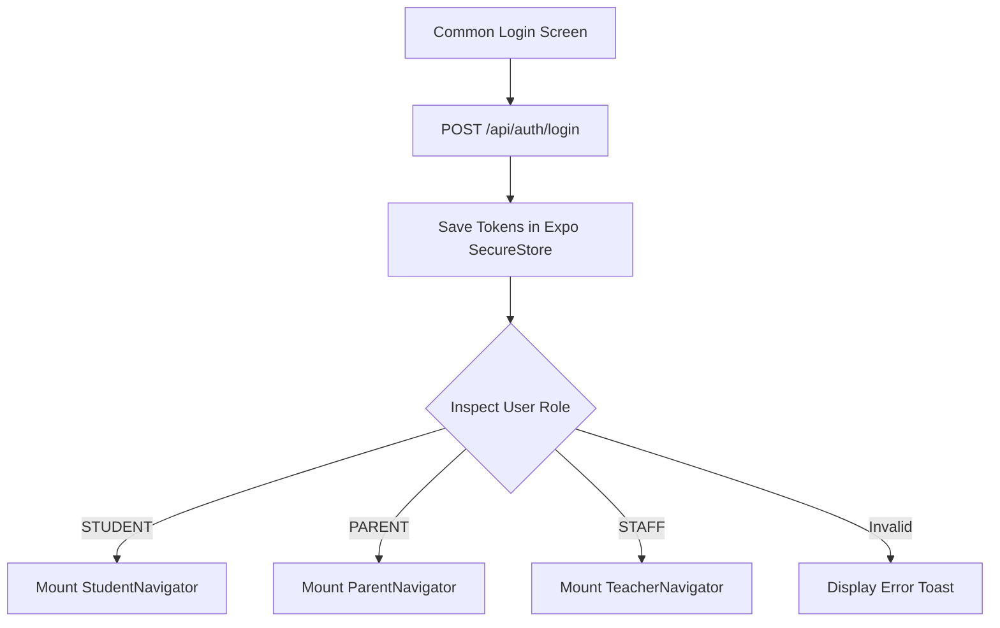

# Digital Guru Franchise — Mobile Architecture & Technical Design

**Document:** `docs/mobile-architecture.md`  
**Date:** November 23, 2026  
**Status:** COMPLETE DESIGN  
**Scope:** Architecture, navigation, state management, API integration, and build pipelines for `apps/mobile` (Expo + React Native + TypeScript).

---

## 1. Architectural Principles & Technology Stack

The mobile application is designed as a first-class workspace inside the existing monorepo (`apps/mobile`), sharing domain models, design tokens, and utilities from `@tuition/shared` without duplicating backend logic or creating a secondary database.

```
+-----------------------------------------------------------------------------------+
|                            apps/mobile (Expo SDK 51)                              |
|                                                                                   |
|  +-----------------------------------------------------------------------------+  |
|  |                     Role-Based Root Navigator Router                        |  |
|  +-----------------------------------------------------------------------------+  |
|       |                           |                               |               |
|       v                           v                               v               |
|  +-----------------+     +-----------------+             +-----------------+      |
|  |   Student App   |     |   Parent App    |             |   Teacher App   |      |
|  | (Learning & HW) |     | (Child Progress)|             | (Roster & Mark) |      |
|  +-----------------+     +-----------------+             +-----------------+      |
|                                                                                   |
|  +-----------------------------------------------------------------------------+  |
|  |  Data Layer: TanStack Query v5 (Server Cache) + Zustand (Auth / Session)    |  |
|  +-----------------------------------------------------------------------------+  |
|  |  Network: Axios Client + Token Refresh Interceptor + Expo SecureStore       |  |
|  +-----------------------------------------------------------------------------+  |
|  |  Shared Foundation: @tuition/shared (Theme Tokens, Types, Voice Matching)   |  |
+-----------------------------------------------------------------------------------+
                                         |
                                         | HTTPS (JSON / REST API)
                                         v
+-----------------------------------------------------------------------------------+
|                 Existing Express API Server (http://localhost:5000/api)           |
|                                                                                   |
|  Auth | Academics | Attendance | Homework | Materials | Fees | Notifications     |
+-----------------------------------------------------------------------------------+
                                         |
                                         | Prisma ORM (Connection Pooler)
                                         v
+-----------------------------------------------------------------------------------+
|                  Existing Neon PostgreSQL Dedicated Database                      |
+-----------------------------------------------------------------------------------+
```

### 1.1 Core Stack Specifications

| Layer | Recommended Library | Version | Technical Justification |
|---|---|---|---|
| **Framework** | Expo SDK | `^51.0.0` | Exact alignment with monorepo `React 18.2.0` and `TypeScript ^5.5.4`. Provides native Android and iOS modules via Expo Prebuild / EAS. |
| **Runtime** | React Native | `0.74.5` | Bundled with Expo SDK 51. Supports Hermes JS engine and modern architecture. |
| **Language** | TypeScript | `^5.5.4` | Matches root `tsconfig.json` and `@tuition/shared`. |
| **Navigation** | `@react-navigation/native` + `@react-navigation/bottom-tabs` + `@react-navigation/native-stack` | `^6.x` | Industry standard declarative routing supporting deep linking, dynamic role routing, and fluid native transitions. |
| **Server State** | `@tanstack/react-query` | `^5.50.0` | Automatic background caching, query invalidation, pull-to-refresh, offline persistence, and mutation rollbacks. |
| **Local State** | `zustand` | `^4.5.4` | Minimal footprint, un-opinionated, zero boilerplate store for authentication and active child selection. |
| **Secure Storage** | `expo-secure-store` | `~13.0.2` | Hardware-backed encrypted storage: iOS Keychain and Android Keystore (EncryptedSharedPreferences). |
| **Networking** | `axios` | `^1.7.4` | Flexible request/response interceptors for silent token refresh queues and `x-institute-id` header injection. |
| **Push Notifications** | `expo-notifications` | `~0.28.9` | Cross-platform push token handling, background tap listeners, and OS badge management. |
| **File Handling** | `expo-document-picker` + `expo-image-picker` + `expo-file-system` | SDK 51 | Support for homework document uploads (PDF/Image) and material offline downloads. |
| **Audio & Speech** | `expo-av` + Native Speech-to-Text | SDK 51 | Powers teacher voice attendance transcription in conjunction with `@tuition/shared/voiceMatching`. |
| **Icons & UI** | `lucide-react-native` | `^0.441.0` | Icon parity with desktop web application (`lucide-react`). |

---

## 2. Directory Structure (`apps/mobile`)

The code structure inside `apps/mobile` enforces strict role separation while sharing generic UI components:

```
apps/mobile/
├── assets/                          # App icons, splash screens, brand imagery
├── src/
│   ├── api/
│   │   ├── client.ts                # Axios instance, interceptors, error normalizer
│   │   ├── auth.api.ts              # Login, refresh, session calls
│   │   ├── student.api.ts           # Student portal endpoints
│   │   ├── parent.api.ts            # Parent portal endpoints
│   │   ├── teacher.api.ts           # Teacher portal endpoints
│   │   └── notifications.api.ts     # Push token registration, alert polling
│   ├── components/
│   │   ├── common/                  # Button, Card, Input, Badge, ScreenWrapper, Avatar
│   │   ├── feedback/                # LoadingSpinner, ErrorState, EmptyState
│   │   └── media/                   # PdfViewerModal, AudioPlayer, PhotoPreview
│   ├── features/
│   │   ├── auth/                    # LoginScreen, ForceChangePasswordModal
│   │   ├── student/                 # StudentDashboard, HomeworkScreen, MaterialsScreen, AttendanceScreen
│   │   ├── parent/                  # ParentDashboard, ChildSelector, FeesScreen, FeedbackScreen
│   │   └── teacher/                 # TeacherDashboard, BatchDetailScreen, VoiceAttendanceScreen, GradeHomeworkScreen
│   ├── hooks/
│   │   ├── useAuth.ts               # Login state, role checks, logout
│   │   ├── useNotifications.ts      # Push token listener & deep link handler
│   │   └── useVoiceAttendance.ts    # Voice recognition and student matching
│   ├── navigation/
│   │   ├── RootNavigator.tsx        # Conditional root: AuthStack vs RoleStacks
│   │   ├── AuthNavigator.tsx        # Login and password setup screens
│   │   ├── StudentNavigator.tsx     # Student bottom tab navigation
│   │   ├── ParentNavigator.tsx      # Parent bottom tab navigation
│   │   └── TeacherNavigator.tsx     # Teacher bottom tab navigation
│   ├── store/
│   │   ├── authStore.ts             # User, tokens, active role, institute context
│   │   └── parentStore.ts           # Selected active child ID
│   ├── theme/
│   │   └── index.ts                 # Consumes themeTokens from @tuition/shared
│   └── utils/
│       ├── storage.ts               # SecureStore wrapper for tokens
│       └── formatters.ts            # Date, currency, status badge helpers
├── app.json                         # Expo configuration (bundle ID, permissions, plugins)
├── eas.json                         # EAS Build configuration (development, preview, production)
├── package.json                     # Dependencies with Expo SDK 51
└── tsconfig.json                    # Extends monorepo root tsconfig
```

---

## 3. Authentication & Role Routing Architecture

### 3.1 Common Login Flow
The app presents a single, unified login screen (`src/features/auth/LoginScreen.tsx`):
1. **User Input**:
   - `identifier`: Email, Phone Number, or Student Admission Number.
   - `password`: User password.
2. **Submission**:
   - Dispatches `POST /api/auth/login`.
3. **Response Processing**:
   - Securely persists `accessToken` and `refreshToken` in `expo-secure-store`.
   - Stores user metadata (`user.id`, `user.role`, `user.fullName`, `institute`) in Zustand `authStore`.
4. **Dynamic Navigation Dispatch**:
   - `RootNavigator` observes `authStore.role` and conditionally mounts the target stack:
     - `role === 'STUDENT'` &rarr; `<StudentNavigator />`
     - `role === 'PARENT'` &rarr; `<ParentNavigator />`
     - `role === 'STAFF'` &rarr; `<TeacherNavigator />`
     - Other / Unauthenticated &rarr; `<AuthNavigator />`



---

## 4. Network Client & Token Interceptor Architecture

The Axios client (`src/api/client.ts`) guarantees resilient connectivity:
1. **Request Interceptor**:
   - Injects `Authorization: Bearer <accessToken>` retrieved from SecureStore.
   - Injects `x-institute-id: <instituteId>` from active user context.
2. **Response Interceptor (401 Handling & Silent Refresh Queue)**:
   - When an API request returns `401 Unauthorized`:
     - Checks if refresh is already in-flight.
     - If not, locks the queue and dispatches `POST /api/auth/refresh` with `refreshToken`.
     - Upon receiving new tokens, updates SecureStore, releases the queue, and replays all pending requests.
     - If the refresh token is expired or user is deactivated, clears SecureStore and forces user back to `<AuthNavigator />`.

---

## 5. Distinct Role-Specific Mobile Experiences

### 5.1 Student Experience (`StudentNavigator`)
- **Theme Accent**: Brand Blue (`#006FFF`).
- **Tab 1: Dashboard**:
  - Today's classes timetable carousel.
  - Quick action: "Submit Pending Homework".
  - Recent attendance card with percentage meter.
  - Gamification banner: XP Points and current level.
- **Tab 2: Academics & Timetable**:
  - Weekly schedule view.
  - Learning materials list grouped by subject with in-app PDF preview and download.
- **Tab 3: Homework**:
  - Filter by "Pending" vs "Submitted".
  - Camera/File picker to submit completed homework photos/PDFs.
  - View graded submissions with teacher remarks and scores.
- **Tab 4: Notifications & Profile**:
  - In-app notification feed with deep-link taps.
  - Personal details, admission number, and digital student ID card.

### 5.2 Parent Experience (`ParentNavigator`)
- **Theme Accent**: Warm Slate / Navy (`#0F172A`) with Gold Highlights (`#FEDC32`).
- **Child Selector Bar**: Persistent top dropdown allowing multi-child parents to switch between children with instant UI re-scoping.
- **Tab 1: Daily Overview**:
  - Real-time check-in and check-out status banner with timestamp.
  - Today's homework status indicator.
  - Fee payment due alert banner.
- **Tab 2: Attendance History**:
  - Interactive monthly calendar with colored markers (Green = Present, Red = Absent, Yellow = Late).
  - Monthly attendance percentage score.
- **Tab 3: Fees & Payments**:
  - Total outstanding balance card.
  - Itemized fee structures.
  - One-tap "Pay with UPI / Card" button integrating Razorpay checkout.
  - Downloadable receipts for previous payments.
- **Tab 4: Inquiries & Feedback**:
  - Direct message/feedback thread with class teachers.
  - Create new inquiry with categories (Academic, Transport, Discipline, Fees).

### 5.3 Teacher Experience (`TeacherNavigator`)
- **Theme Accent**: Energetic Orange (`#FE4D01`) & Navy.
- **Tab 1: Classes & Dashboard**:
  - Today's teaching schedule with countdown to next lecture.
  - One-tap "Mark Attendance" shortcut.
  - Work attendance status (Geofence punch-in status).
- **Tab 2: Attendance & Voice**:
  - Manual student checklist.
  - **Voice Attendance Screen**: Live speech transcription using phone microphone; fuzzy matches student names against active batch roster via `@tuition/shared/voiceMatching`.
- **Tab 3: Homework & Grading**:
  - Homework creator with document attachment.
  - Submission review inbox: View student submission images/PDFs and assign numerical marks with text feedback.
- **Tab 4: Parent Communication & Notifications**:
  - Incoming inquiries from parents with quick response composer.
  - Institute announcements.

---

## 6. Real-Time Push Notifications Architecture

```
Backend Notification Event (e.g. Check-In, New Homework)
       |
       v
Prisma: Save to Notification table
       |
       v
Push Dispatcher Worker: Fetch DevicePushToken for target userId
       |
       v
Expo Push Notification Service (HTTPS)
       |
       +-----------------------+
       |                       |
       v                       v
Apple APNs (iOS)       Google FCM (Android)
       |                       |
       +-----------------------+
       |
       v
Mobile Device (expo-notifications listener)
       |
       +---> App in Foreground: Show custom in-app banner toast
       |
       +---> App in Background / Locked: Native OS banner
               |
               v
         User Taps Push
               |
               v
      Deep-Link Dispatcher
    (Navigates directly to target screen via entityType & entityId)
```

- When notification arrives with `entityType: 'HOMEWORK'` and `entityId: 'uuid'`, tapping the notification jumps directly to `HomeworkDetailScreen({ id: 'uuid' })`.

---

## 7. Build, Deployment & Platform Configuration

### 7.1 Android Configuration (`app.json`)
- Package Name: `com.digitalghuru.franchise`
- Min SDK Version: `24` (Android 7.0+)
- Target SDK Version: `34` (Android 14+)
- Permissions: `CAMERA`, `READ_EXTERNAL_STORAGE`, `ACCESS_FINE_LOCATION` (Teacher geofence attendance), `RECORD_AUDIO` (Teacher voice attendance).

### 7.2 iOS Configuration (`app.json`)
- Bundle Identifier: `com.digitalghuru.franchise`
- Supported Devices: iPhone & iPad (`universal: false`, optimized for phone)
- Info.plist Usage Descriptions:
  - `NSCameraUsageDescription`: "Digital Guru requires camera access to upload homework and profile documents."
  - `NSPhotoLibraryUsageDescription`: "Digital Guru requires photo library access to upload assignments and receipts."
  - `NSLocationWhenInUseUsageDescription`: "Digital Guru requires location access to verify staff attendance within campus geofence."
  - `NSMicrophoneUsageDescription`: "Digital Guru requires microphone access for voice-assisted attendance marking."

### 7.3 EAS Build Profiles (`eas.json`)
- `development`: Internal debug client with Expo Dev Client.
- `preview`: Internal testing APK (Android) and Ad-Hoc / TestFlight build (iOS).
- `production`: Optimized AAB for Google Play Store and IPA for Apple App Store.
