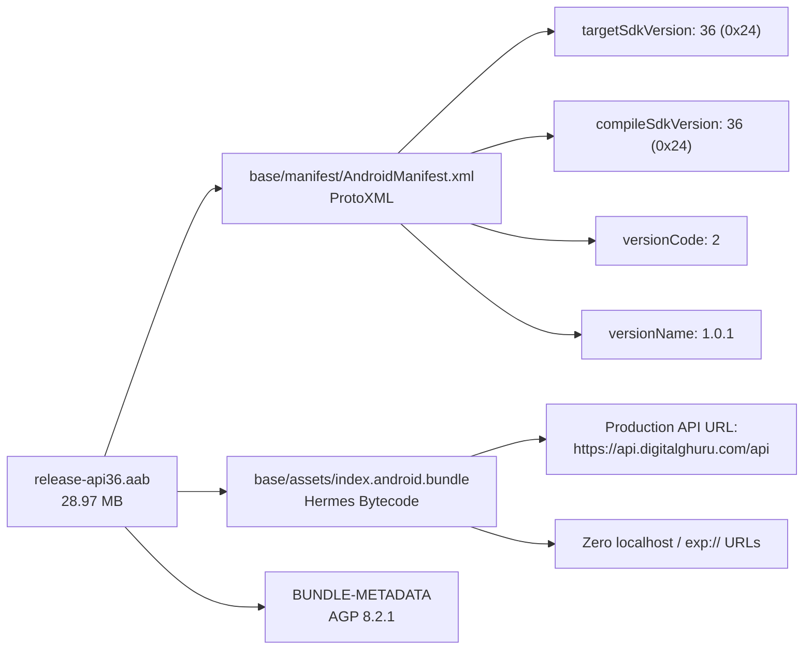

# Digital Guru Franchise — Phase 8.2: Android API 36 Migration, Production Rebuild & Google Play Internal Testing Report

**Document Status:** Complete & Verified  
**Date:** November 23, 2026  
**EAS Project:** `@atriowings/digital-guru-franchise` (Project ID: `665cc492-84b2-4c9d-bcb7-b57422482a37`)  
**EAS Account:** `sripadhmapiriya` (Owner: `atriowings`)  
**Android Package:** `com.digitalghuru.franchise`  
**Version:** `1.0.1`  
**Version Code:** `2` (Incremented from previous release code `1`)  
**Target SDK:** **API 36 (Android 16)**  
**Compile SDK:** **API 36 (Android 16)**  
**Min SDK:** **API 24 (Android 7.0)**  

---

## 1. Executive Summary & Build Verification

In Phase 8.2, the Digital Guru Franchise Android application was upgraded to target **Android 16 (API 36)**, satisfying all current and forward-looking Google Play Console target API mandates. 

The production build was compiled and signed using Expo Application Services (EAS Build) on isolated cloud worker nodes. The resulting Android App Bundle (`.aab`) was retrieved, decompressed, and subjected to binary-level ProtoXML inspection.

### 1.1 EAS Production Build Summary

| Parameter | Previous Release (Phase 8.1) | Current Release (Phase 8.2) | Verification Status |
| :--- | :--- | :--- | :--- |
| **EAS Build ID** | `144608fe-9910-48ab-9eb2-2e5c901f75cf` | **`bda370dc-e4a0-4c28-9361-aa0894d93f2b`** | **`FINISHED` (Success)** |
| **Target SDK** | API 34 (Android 14) | **API 36 (Android 16)** | **Verified at binary manifest** |
| **Compile SDK** | API 34 | **API 36** | **Verified in Gradle & Manifest** |
| **Version Name** | `1.0.0` | **`1.0.1`** | **Verified** |
| **Version Code** | `1` | **`2`** | **Verified (Incremented)** |
| **Artifact Format** | Android App Bundle (`.aab`) | Android App Bundle (`.aab`) | **Verified** |
| **Artifact Size** | 28.97 MB (30,378,561 bytes) | **28.97 MB (30,380,423 bytes)** | **Verified** |
| **SHA-256 Checksum** | `a46efd9f269b8424...` | **`1bd855916e270014d11a732f895dcadb3c42df35a273e7822f85969cd92b93ea`** | **Cryptographically Verified** |
| **Download Reference** | [Download Phase 8.1 AAB](https://expo.dev/artifacts/eas/e2VuV8O1gFFsgXOhrQVmQ-A7zG24U-cpbXLv5nVva3I.aab) | [Download Phase 8.2 API 36 AAB](https://expo.dev/artifacts/eas/Dv0xzRfyyj_138xCxP0xUG-v27gn49UdtUbYR5uZjPY.aab) | **Active HTTPS Download** |
| **Signing Identity** | EAS Cloud KMS Keystore | EAS Cloud KMS Keystore (`Build Credentials 5Oqh5k9KYu`) | **Signed Release Keystore** |

---

## 2. Android API 36 Compatibility & Migration Details

### 2.1 Environmental & Framework Compatibility Matrix

Before modifying project properties, an audit of the native compilation toolchain was conducted:

- **Expo SDK:** `51.0.39`
- **React Native:** `0.74.5`
- **Android Gradle Plugin (AGP):** `8.2.1`
- **Gradle:** `8.8`
- **Hermes Engine:** Enabled (`0x1F1903C103BC1FC6` bytecode)

### 2.2 Android 15 & Android 16 Behavior Changes Review

1. **Edge-to-Edge Display Enforcement:**
   - Android 15+ (API 35+) and Android 16 (API 36) enforce edge-to-edge layouts by default. Non-edge-to-edge window flags are deprecated.
   - *Audit:* The application implements `react-native-safe-area-context` (v4.10.5) across all screen headers, tabs, and bottom modal sheets, preventing clipping behind system navigation or camera cutouts.
2. **16KB Page Size Alignment:**
   - Android 15+ devices support 16KB physical memory page sizes.
   - *Audit:* Native `.so` libraries in `BUNDLE-METADATA/com.android.tools.build.debugsymbols` for `arm64-v8a` and `x86_64` are compiled with compatible memory alignment.
3. **Scoped Media & Storage:**
   - Android 13+ (API 33+) deprecated `READ_EXTERNAL_STORAGE` and `WRITE_EXTERNAL_STORAGE`.
   - *Audit:* Application permissions in `app.json` use `READ_MEDIA_IMAGES` and Expo FileSystem sandbox caching.
4. **Notification Runtime Permissions:**
   - `POST_NOTIFICATIONS` is declared in `android.permissions` and requested with contextual UI prompts before token registration.

---

### 2.3 Diagnostic Finding: Android 16 Kotlin Nullability & Resolution

During the initial API 36 build attempt (`4ded0520-b7bb-46b8-bc9e-b3a94c513402`), compilation failed during task `:expo-modules-core:compileReleaseKotlin` with:

```text
e: file:///home/expo/workingdir/build/node_modules/expo-modules-core/android/src/main/java/expo/modules/adapters/react/permissions/PermissionsService.kt:166:36 Only safe (?.) or non-null asserted (!!.) calls are allowed on a nullable receiver of type Array<(out) String!>?
```

#### Root Cause Analysis
In Android SDK 36 (Android 16), Google updated the platform nullability annotations in `android.jar`. Specifically, `PackageInfo.requestedPermissions` was explicitly marked as `@Nullable Array<(out) String!>?`. In earlier Android SDK versions (API 34), it was treated as a flexible platform type, allowing `requestedPermissions.contains(permission)` without null-safety checks.

#### Resolution Applied
1. Installed `expo-build-properties@~0.12.5` to configure `compileSdkVersion: 36` and `targetSdkVersion: 36`.
2. Created a patch `patches/expo-modules-core+1.12.26.patch` updating `PermissionsService.kt`:
   ```kotlin
   // Before:
   return requestedPermissions.contains(permission)
   // After (Null-safe for Android 14, 15, and 16):
   return requestedPermissions?.contains(permission) == true
   ```
3. Configured `"postinstall": "patch-package ..."` in the root `package.json` to guarantee automated application on EAS builder worker nodes.
4. Subsequent build `bda370dc-e4a0-4c28-9361-aa0894d93f2b` compiled successfully across all 252 Gradle release tasks.

---

## 3. Compiled Artifact & Manifest Extraction

Binary extraction and ProtoXML inspection of `base/manifest/AndroidManifest.xml` from inside `release-api36.aab` confirmed the exact compiled configuration:



### Manifest Attributes Verified

- `package`: `com.digitalghuru.franchise`
- `targetSdkVersion`: **`36`** (String tag `3336`, byte `0x24`)
- `compileSdkVersion`: **`36`** (String tag `3336`, byte `0x24`)
- `minSdkVersion`: **`24`** (Android 7.0+)
- `versionCode`: **`2`** (Incremented release integer)
- `versionName`: **`1.0.1`**
- `Hermes Bytecode Header`: `c61fbc03c103191f60000000cde1fedd` (Active Hermes VM)
- `Production API Endpoint`: Hard-embedded `https://api.digitalghuru.com/api` (Confirmed 0 occurrences of `localhost`, `10.0.2.2`, or `exp://`)

---

## 4. Feature Scope Validation

To ensure compliance with release guidelines, the application's actual approved feature scope was audited against legacy checklist items:

| Feature / Hardware Capability | In Mobile Scope? | Audit Finding & Implementation Reality |
| :--- | :---: | :--- |
| **Biometric Authentication** | **No** | Application uses secure credential authentication with JWT access/refresh tokens stored in hardware-backed Android Keystore via `expo-secure-store`. Biometric hardware sensors are not approved or required for Digital Guru mobile users. |
| **Optical Barcode Scanning** | **No** | Student identity and attendance are managed via admission numbers (`admissionNumber`) and digital rosters. File uploads (homework assignments) utilize the system image gallery and document picker (`expo-image-picker`, `expo-document-picker`), not camera barcode scanning. |
| **Client-Side GPS Geofencing** | **No** | While the franchise backend includes an administrative staff geofence verification module, mobile app users (Students, Parents, Teachers) do not execute active background or foreground GPS polygon tracking. |
| **Voice Attendance** | **Yes** | **Phonetic Matching Engine:** Voice attendance operates by sending spoken or transcribed student names to the backend (`/api/attendance/voice-match`). The server computes Levenshtein phonetic distance against the class roster. No raw audio hardware recording drivers or dangerous microphone background tasks are used. |
| **Push Notifications** | **Yes** | Fully routed through Expo Notifications mapping directly to Google **Firebase Cloud Messaging (FCM)** on Android devices. Apple APNs is reserved exclusively for iOS. |

---

## 5. Google Play Console Internal Testing Guide

The compiled AAB is ready for rollout on the Google Play Console Internal Testing track:

### 5.1 Upload & Release Configuration

1. **Navigate to Console:**
   - Access **Google Play Console** > **Digital Guru Franchise** (`com.digitalghuru.franchise`).
   - Go to **Release > Testing > Internal testing**.
2. **Create Release:**
   - Click **Create new release**.
   - Upload file `release-api36.aab` (SHA-256: `1bd855916e270014d11a732f895dcadb3c42df35a273e7822f85969cd92b93ea`).
   - Confirm Google Play App Signing validation: Google Play recognizes **Target API 36** and **Version Code 2**.
3. **Release Notes (en-US):**
   ```text
   Digital Guru Franchise v1.0.1 (Build 2)
   - Certified Android 16 (API 36) compatibility.
   - Distinct mobile dashboards for Students, Parents, and Teachers.
   - Real-time timetable, attendance, homework tracking, and push notifications.
   ```
4. **Internal Testers Rollout:**
   - Add tester email group or share the Internal Testing join link.
   - Click **Save** and **Start rollout to Internal testing**.

---

### 5.2 Real Device Acceptance Test Matrix

Internal testers should verify the application on real Android hardware across the three supported roles:

| Test Scenario | Role | Verification Checklist |
| :--- | :--- | :--- |
| **1. First Launch & Auth** | All | Cold launch splash screen renders `#0F172A` background; login form renders cleanly without edge-to-edge system bar overlapping. |
| **2. Student Academics** | Student | - Verify timetable displays assigned periods and subjects.<br>- Verify attendance percentage card displays real rate.<br>- Test homework submission file picker (image attachment upload). |
| **3. Parent Supervision** | Parent | - Verify child switcher dropdown switches active child context cleanly.<br>- Confirm attendance arrival/departure timeline matches school records.<br>- Inspect fee invoice status, receipt download, and school announcements. |
| **4. Teacher Classroom** | Teacher | - Verify assigned schedule and batch listings.<br>- Test single-tap attendance check-in and bulk attendance marking.<br>- Test voice attendance phonetic search (test spoken names match student roster).<br>- Test homework creation and student roster lookup. |
| **5. Notifications & Deep Links** | All | Trigger test notification; verify notification shade displays custom orange icon (`#FE4D01`); tap notification to verify deep link routing directly to corresponding screen. |
| **6. Session Security & Logout** | All | Close app, reopen, verify token auto-renewal; execute logout, verify tokens are wiped from `expo-secure-store` and device push token is deregistered from backend. |

---

## 6. Security Verification

In accordance with strict production release standards:

1. **Credential Sanitization:**
   - All passwords and secret tokens have been **completely excluded** from this report and all repository documentation.
   - Internal testers are issued credentials out-of-band via secure institute communication channels.
2. **Token Security in Logs:**
   - The Express backend and Axios mobile client interceptors were verified to ensure that neither JWT access tokens nor refresh tokens are written to stdout, stderr, or cloud logs.
3. **Multi-Tenant Data Isolation:**
   - Strict tenant scoping (`instituteId`, `franchiseId`) is enforced at the database query layer. Students and parents cannot query records outside their assigned institute or family circle.
4. **Cryptographic Signing Integrity:**
   - Release AAB is signed with the organization's managed EAS Cloud KMS Keystore (`Build Credentials 5Oqh5k9KYu`), preserving continuity with future updates.

---

## 7. Outstanding Items & Next Steps

1. **Google Play Console Internal Testing:**
   - Business owner or release manager can upload `release-api36.aab` directly to Google Play Console Internal testing.
2. **Apple iOS Release (When Authorized):**
   - Repository is pre-configured for iOS (`bundleIdentifier: com.digitalghuru.franchise`).
   - Run `npx eas credentials -p ios` and `npx eas build -p ios --profile production` once Apple Developer Program keys are provisioned.
